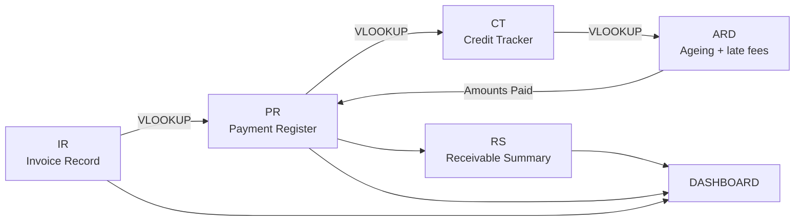

# Accounts Receivable Tracker (Excel)

An Excel model that tracks 100 customer invoices from issue to payment, applies a 50% advance deposit, monitors credit terms, charges tiered late fees on overdue balances, and summarises everything on a dashboard.

> **Snapshot date:** all figures below are as at **20 October 2026** (the model uses `TODAY()`, so numbers move when the file is reopened on a later date).

---

## 1. Objective

Businesses that sell on credit need to know, at any moment, **who has paid, who still owes, how overdue each balance is, and what late charges apply**. This project builds that view in Excel from a single invoice list, so that entering one payment automatically updates every other sheet.

## 2. Workbook structure

| Sheet | Full name | Purpose |
|---|---|---|
| `COVER` | Table of Contents | Navigation, abbreviations and the model's key assumptions |
| `DASHBOARD` | Dashboard | KPI totals, pivot tables, four charts and the Paid / Unpaid / Due summary |
| `IR` | Invoice Record | Master data: 100 invoices (number, customer, date, amount, note, payment reference). **The only sheet with raw invoice data** |
| `PR` | Payment Register | Deposit logic: deposit date, deposit amount, outstanding balance, and the **Input Amount (If paid)** column where actual payments are entered |
| `CT` | Credit Tracker | Credit terms (30 days) per invoice, with deposit and outstanding balance pulled from `PR` |
| `ARD` | Accounts Receivable Data | Ageing engine: days of credit used, days overdue, late-fee lookup and the final *Amounts Paid* figure |
| `RS` | Receivable Summary | Per-invoice status (Paid / Due / Overpaid) and overpaid amounts |

### How the sheets connect

## 3. Key assumptions

1. **Advance deposit of 50%.** If no payment is typed in, each customer is assumed to have paid 50% of the invoice.
2. **Deposit date = invoice date + 2 working days** (`WORKDAY`). It is calculated, not typed, on the assumption that customers pay within one or two working days.
3. **Actual payments override the assumption.** Entering an amount in `PR` → *Input Amount (If paid)* replaces the 50% figure, and all downstream sheets recalculate.
4. **Credit terms are 30 days** for every invoice (editable per row in `CT`).
5. **Grace period:** at 31 days an invoice is 1 day overdue but is *not* charged; charges start at 32 days (2 days overdue).
6. **Dataset limit:** the model holds exactly **100 invoices** (`INV-2026-001` to `INV-2026-100`, dated 2 Jun – 30 Oct 2026). To add more, extend the tables on a separate set of columns.

## 4. Sheet-by-sheet description

### IR – Invoice Record
Columns: Customer Invoice Number · Customer Name · Date of Invoice · Invoice Amount (£) · Note (service type) · Payment Reference.

Ten service categories (consulting, equipment, maintenance, marketing, subscriptions, office supplies, project delivery, software licences, stationery, training), 10 invoices each. Invoice amounts range from £265.50 to £2,850.00.

### PR – Payment Register
| Column | Logic |
|---|---|
| Invoice Number | Linked to `IR` |
| Customer, Date, Amount, Note, Reference | `VLOOKUP` from `IR` |
| Input Amount (If paid) | **Manual input** – actual amount received (12 invoices have one) |
| Date of Deposit | `=WORKDAY(invoice date, 2)` |
| Deposit Amount | `=IF(input=0, amount*50%, input)` |
| Outstanding Amount | `=IF(deposit=amount, "Paid All", amount-deposit)` (negative = overpayment) |
| Amounts Paid | Pulled from `ARD` (includes late charges, see below) |

### CT – Credit Tracker
Pulls invoice details, deposit and outstanding balance from `PR` using structured table references, and holds the **Credit Terms (Days)** input (30).

### ARD – Accounts Receivable Data
The ageing engine.

* **Days of Credit** = `TODAY()` − invoice date (only while a balance is outstanding)
* **Due Days** = Days of Credit − Credit Terms (blank if still within terms)
* **Amounts Paid** = deposit amount if the invoice is settled, overpaid or not more than 1 day overdue; otherwise outstanding balance × (1 + late-fee %)

**Late-fee schedule** (`ARD!Q7:R21`, looked up on Due Days):

| Days overdue | 2 | 5 | 10 | 15 | 20 | 25 | 30 | 35 | 40 | 45 | 50 | 55 | 60 | 70+ |
|---|---|---|---|---|---|---|---|---|---|---|---|---|---|---|
| Fee on outstanding | 1% | 2% | 5% | 8% | 11% | 14% | 17% | 20% | 23% | 26% | 29% | 32% | 35% | 38% |

As at the snapshot date, 40 invoices are overdue enough to attract a charge, adding £2,199.45 in late fees.

### RS – Receivable Summary
Mirrors `PR` and adds a status for each invoice:

| Status code | Status | Meaning |
|---|---|---|
| `P` | PAID | Deposit equals invoice amount |
| `D` | DUE | Balance still outstanding |
| `U` | UNPAID | Outstanding balance is negative, i.e. the customer **overpaid** (shown in *Overpaid Amount*) |

Conditional formatting highlights settled invoices and overpayments.

### DASHBOARD
**KPIs (live formulas)**

| Metric | Value |
|---|---|
| Total invoices | 100 |
| Total invoice amount | £112,488.60 |
| Average / minimum / maximum invoice | £1,124.89 / £265.50 / £2,850.00 |
| Total deposit amount | £61,279.43 |
| Total outstanding amount (net of overpayments) | £51,209.18 |
| Total *Amounts Paid* | £63,478.88 |
| Invoices PAID / UNPAID (overpaid) / DUE | 8 / 3 / 89 |

**Breakdown by service category**

| Category | Invoices | Invoiced | Deposits | Outstanding | Amounts Paid |
|---|---|---|---|---|---|
| Consulting services | 10 | £15,023.25 | £7,511.63 | £7,511.63 | £7,674.92 |
| Equipment purchase | 10 | £15,181.50 | £8,698.38 | £6,483.13 | £8,704.53 |
| Maintenance services | 10 | £6,362.25 | £3,451.13 | £2,911.13 | £3,603.41 |
| Marketing services | 10 | £10,113.05 | £5,351.53 | £4,761.53 | £5,615.96 |
| Monthly subscription | 10 | £7,977.00 | £5,056.00 | £2,921.00 | £5,306.23 |
| Office supplies | 10 | £8,161.75 | £4,443.38 | £3,718.38 | £4,462.01 |
| Project delivery | 10 | £14,382.05 | £7,191.03 | £7,191.03 | £7,794.65 |
| Software licence | 10 | £15,342.75 | £8,508.88 | £6,833.88 | £9,039.88 |
| Stationery order | 10 | £9,477.25 | £4,871.38 | £4,605.88 | £4,918.02 |
| Training services | 10 | £10,467.75 | £6,196.13 | £4,271.63 | £6,359.28 |
| **Total** | **100** | **£112,488.60** | **£61,279.43** | **£51,209.18** | **£63,478.88** |

The dashboard also contains pivot tables and four charts: deposits by category, amounts paid by category, outstanding vs amounts paid vs deposits by category, and the Paid / Unpaid / Due count.

## 5. How to use

1. Open `PR` and type the amount a customer actually paid in **Input Amount (If paid)** on that invoice's row.
2. Leave the cell blank to keep the 50% deposit assumption.
3. Go to **Data → Refresh All** so the pivot tables and charts on the dashboard pick up the change; everything else recalculates automatically.

## 6. Excel skills demonstrated

`VLOOKUP` (exact and approximate match) · `WORKDAY` · `TODAY` · nested `IF` / `OR` · `COUNTIF` · `SUM` / `AVERAGE` / `MIN` / `MAX` · `SUBTOTAL` · Excel Tables with structured references · conditional formatting · pivot tables · charts · multi-sheet model design · assumption documentation

## 7. Known limitations and possible improvements

* **Amounts Paid mixes two definitions.** For settled invoices it shows the deposit; for overdue ones it shows the outstanding balance plus the late fee and does not add back the deposit already received. A "total receivable" column (deposit + balance + fee) would be clearer.
* **Status label.** "UNPAID" (status code `U`) actually flags *overpayments*; renaming it "OVERPAID" would be more accurate.
* **Approximate-match `VLOOKUP`.** Lookups rely on invoice numbers being sorted; adding the exact-match argument (`FALSE`) or moving to `INDEX`/`MATCH` would make them robust.
* **Table ranges** extend a few rows past the 100 invoices (spare rows in `PR`, `CT`, `ARD`, `RS`).
* **Future-dated record:** `INV-2026-099` is dated 30 Oct 2026, after the snapshot date, yet its assumed deposit is already counted.
* **Fixed late-fee schedule and 30-day terms** apply to every customer; per-customer terms or a fee cap could be added.
* **Pivot tables** need a manual refresh after any data change.

## 8. Author

Hinshu Joshi – built as a hands-on practice project for finance and commercial analyst roles. Feedback is welcome.
